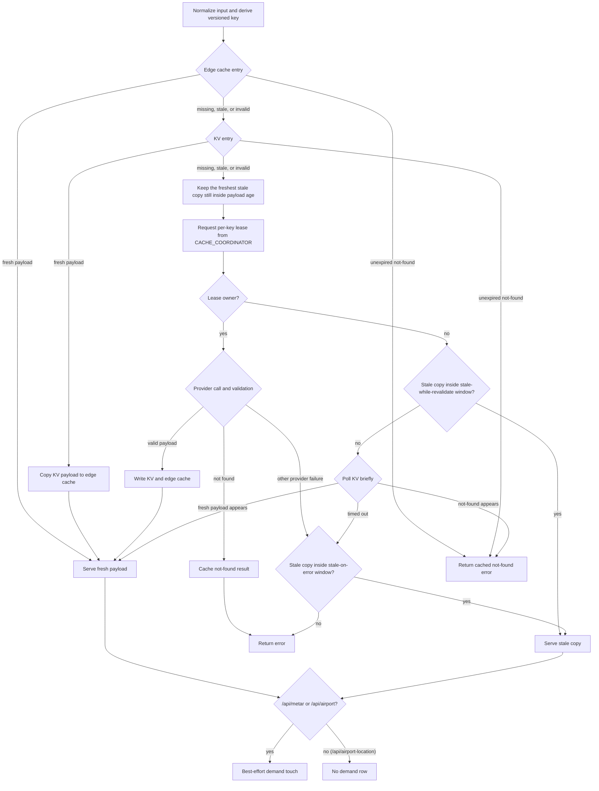
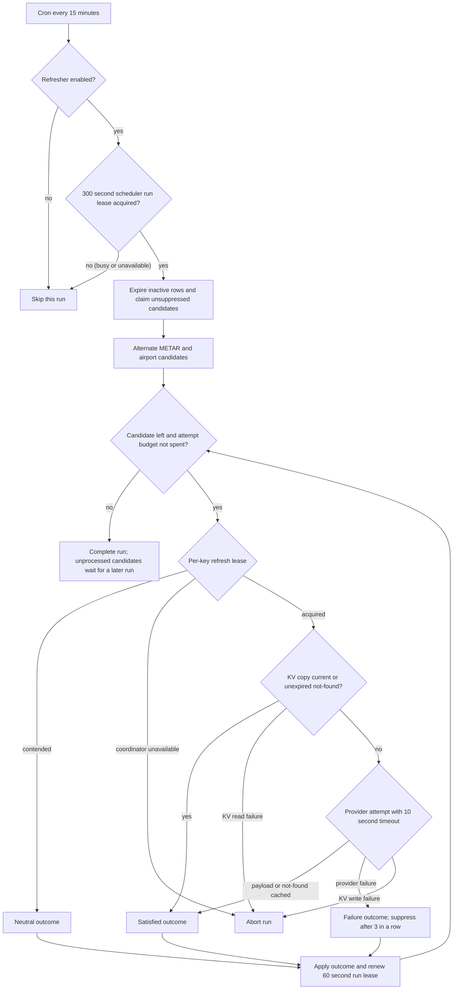

# Cache Architecture

The METAR Worker uses a Cloudflare-native, adapter-driven cache. Its design has
two deliberately separate concerns:

1. serve validated resource data safely and efficiently; and
2. refresh recently requested data fairly, without allowing cache bookkeeping to
   corrupt request behavior.

The boundary is important: cached payloads live in KV, while the Durable Object
owns the complete demand-record lifecycle and all scheduler state.

## Design goals

- Reuse validated data across users and avoid unnecessary provider traffic.
- Fail safely when a cached record is malformed, too old, or inconsistent with
  the request.
- Permit bounded stale serving where a resource policy allows it, but never
  extend a hard payload-age limit.
- Keep client demand independent of refresh scheduling so a busy client cannot
  overwrite scheduler state.
- Make scheduled refreshes bounded, fair between METAR and airport data, and
  recoverable after a Worker, KV, or provider failure.

## Components and ownership

| Component | Owns | Does not own |
| --- | --- | --- |
| Edge cache (`caches.default`) | Disposable local copy of a validated payload | Scheduler state or source of truth |
| KV (`METAR_CACHE`) | Versioned payload envelopes | Demand records, cursors, leases, or refresh failure counters |
| `CACHE_COORDINATOR` Durable Object | Per-key single-flight locks and the transactional demand/scheduler state machine | Cached payload bodies |
| Resource adapter | Input normalization, provider access, data validation, and resource policy | Cross-resource scheduling |

This split is intentional. KV is excellent for read-heavy payload data and
short-lived demand hints, but it is not used as a compare-and-swap coordination
store. The Durable Object provides serialized, durable transitions for the
state that must not race: active scheduler ownership, opaque continuations,
failure counts, and pending removals. No external cache service, queue, or
additional namespace is required.

## Request path

A validated envelope is served immediately only while it is still fresh. A stale copy is a fallback and never skips refresh. Copies past the payload-age limit, or with malformed metadata, are removed instead of kept. Without a `CACHE_COORDINATOR` binding the request acts as the lease owner. A cache infrastructure failure, such as a failed KV write, returns an error rather than a stale copy. Demand touches run only when the cache refresher is enabled, and a demand-write failure never fails the user request.

METAR freshness ends at the earlier of 30 minutes after `fetchedAt` and 60 minutes after the observation time. If the observation is already older than 60 minutes when fetched, the copy is fresh for only 2 minutes. METAR is never served at or beyond 90 minutes from trusted `fetchedAt`. Airport freshness follows its adapter and is independent of that hard limit.

For a cacheable request, the Worker:

1. normalizes the input and derives a versioned key such as
   `v1:metar:KJFK`;
2. checks the edge cache, then KV;
3. validates every reusable envelope before delivery;
4. on a miss or copy that is not fresh, obtains a token-bound, per-key
   single-flight lease from `CACHE_COORDINATOR`;
5. lets only the lease owner call the provider and write the new envelope;
6. lets other requests serve a policy-allowed stale copy while refresh is in
   progress, or wait briefly for the fresh KV entry and use stale data only
   when the resource policy permits it; and
7. for a successful `/api/metar` or `/api/airport` response, records client
   access as a best-effort coordinator demand touch. `/api/airport-location`
   does not. A demand-write failure never fails the user request.

The cache engine, rather than a resource adapter, writes authoritative envelope
metadata. On both edge and KV reads it checks envelope identity, resource,
policy version, canonical timestamps, and the resource validity horizon.
Malformed or incompatible copies are cache misses and are removed best-effort;
cleanup failure never makes an invalid copy deliverable.

## Payload freshness and public contract

Successful API responses include a `cache` object with `status`, `source`,
`ageSeconds`, `fetchedAt`, `expiresAt`, `maxPayloadAgeSeconds`,
`freshnessRemainingSeconds`, `servedAt`, `ttlSeconds`, `key`, and `resource`.
`X-Runway-Cache-Status` carries the same canonical status in a header.

Fresh response headers are derived from remaining freshness and cap downstream
`max-age` at 60 seconds. Stale and zero-remaining responses are `no-store`, so
a downstream cache cannot lengthen the Worker policy.

METAR freshness ends at the earlier of 30 minutes after `fetchedAt` and 60
minutes after the observation time, and METAR has a strict 90-minute
payload-age limit measured from trusted `fetchedAt`. At or beyond that hard
limit, METAR data is not served—even during an upstream outage. The Worker removes payload copies
from KV and edge cache when possible, while retaining demand metadata so a
later scheduler run or client request can recover the entry. Airport policies
are defined by their adapter and are independent of METAR's hard limit.

## Hot demand and scheduled refresh

Only successful `/api/metar` and `/api/airport` responses enter the hot set.
The named `CACHE_COORDINATOR` owns each demand row in its SQLite storage. A row
contains the canonical resource/key, a coordinator-stamped access time and
expiry, consecutive upstream-failure count, and optional suppression state.
It does **not** contain a payload body. There are no `v2:hot:*` demand keys in
the current design; old keys are ignored and expire naturally.

The budget check runs before each candidate's key lease and KV read. Once the attempt budget (25 upstream attempts by default) is spent, the run ends there, so later candidates wait for a future run even if they would have been cache hits. Cache hits and contention do not use the budget. A KV copy is current when it is still fresh and was fetched within the resource refresh interval (30 minutes for METAR, 24 hours for airport). Client cache hits do not clear suppression; a client request that completes a successful upstream refresh does.

A cron runs every 15 minutes. It obtains the named scheduler lease from
`CACHE_COORDINATOR`, then:

1. atomically expires inactive demand rows, claims a token-bound run, and
   returns bounded METAR and airport candidates from coordinator storage;
2. alternates the oldest candidates by resource, then acquires the same
   token-bound per-key refresh lease used by the request path;
3. while that lease is held, re-reads and validates the authoritative KV
   envelope using the current clock. A current positive envelope or an
   unexpired valid negative envelope satisfies maintenance without a provider
   request; contention is deferred without waiting;
4. performs at most the configured number of real upstream attempts (25 by
   default). Only an actual provider attempt consumes this budget; cache hits
   and contention do not; and
5. renews its scheduler lease and immediately, idempotently applies each
   processed outcome. The continuation advances only for entries that were
   actually processed, so an attempt cap or later failure cannot sink the
   remaining claimed entries.

The initial lease is 300 seconds, which covers the default maximum of 25
sequential ten-second attempts. Each processed entry renews a 60-second lease
with the active run token. An infrastructure failure aborts the remaining run;
already-applied item outcomes and their continuations remain durable, while
unprocessed candidates are retried safely. Every upstream attempt, including
METAR station validation, receives the same 10-second abort signal.

## Failure and recovery semantics

Any satisfied maintenance state resets that entry's failure count: a current
positive or negative envelope, a newly committed positive payload, or a newly
committed adapter-approved stable negative. A failure after a provider attempt
increments the count. Client accesses are neutral. Cache reads/writes,
single-flight coordination, and other scheduler infrastructure failures abort
the remaining run instead: they do not increment a provider-failure count.

This typed maintenance contract is intentionally distinct from the request
cache contract. Request handling may serve stale data, expose HTTP cache
provenance, or reconstruct a stable-negative error for the client. Scheduled
maintenance never interprets those request outcomes or error identities. It
returns only `satisfied`, `deferred`, `provider_failed`, or
`infrastructure_failed`, preventing a foreground negative cache write from
being misclassified as a scheduler failure.

Client touches are neutral: they update expiry but cannot erase failure history
or reactivate a stuck background entry. After three consecutive upstream
failures, the coordinator suppresses that row. Cache-hit and stale traffic
cannot recreate it; only a newer successful payload refresh clears suppression.
This is a true sink for a stuck entry, unlike deleting a record that the next
cache hit immediately recreates. An idempotent Durable Object alarm removes
expired rows and completed-run records even when refresh is disabled.

The scheduler fails closed when its coordinator is unavailable or already
owned. Payload KV read/write failures abort a run without failure-accounting
mutation. Demand bookkeeping never relies on eventually consistent KV reads.

## Why this approach is sound

The architecture uses Cloudflare primitives for the responsibilities they are
good at: KV provides inexpensive payload data and the Durable Object's SQLite
storage owns the authoritative control plane. A demand transition never spans
two storage systems, preventing the lost-update and ambiguous rollback failures
that occur when client touches and failure accounting depend on KV projections.

The scheduler has explicit bounds (scan cap, attempt cap, per-attempt timeout,
lease renewal, and completed-run retention), typed outcomes, and serialized
demand mutations. Validation is at the cache trust boundary, so malformed or
future/incompatible data is not made safe by accident. These are concrete
properties covered by regression tests for slow runs, lease loss, corrupt
metadata, cursor recovery, concurrent touches, and failed dequeue deletion.

This is intentionally a small custom policy layer, not a reimplementation of a
general cache service. It contains the application-specific contracts that a
generic HTTP cache cannot know: resource validation, the METAR hard-age rule,
fairness between resource types, and the three-failure dequeue policy.

## Adapter model and extension

Each adapter defines `resource`, `normalizeKey`, `fetchUpstream`, `validate`,
`serialize`, `deserialize`, `policy`, and `observability`. `deserialize` is a
trust boundary: it must prove every semantic invariant required for a safely
reusable response. Tightening an invariant requires a policy/schema-version
bump so incompatible records refresh.

To add a hot-refreshed resource, add an adapter and route, define its policy,
register it, and add adapter, engine, endpoint, and scheduler tests. The full
refresh input must be reconstructable from the normalized key; variants with
different payload contracts are separate resources. Long-lived reference data
such as `airport-location` remains outside the hot scheduler.

## Runtime bindings and operations

`workers/metar-proxy/wrangler.jsonc` binds `METAR_CACHE` and
`CACHE_COORDINATOR`; preview uses the corresponding isolated bindings. The
coordinator is a SQLite-backed Durable Object declared by the
`v1-cache-coordinator` migration.

Operational controls, diagnostics, and safe intervention procedures are in
[cache-refresh-operations.md](./cache-refresh-operations.md).
